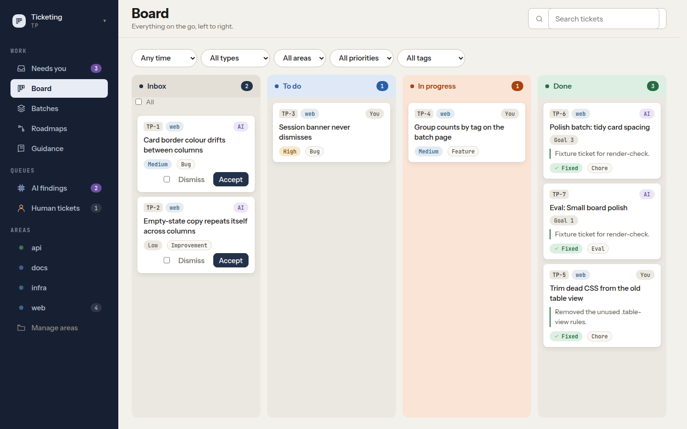
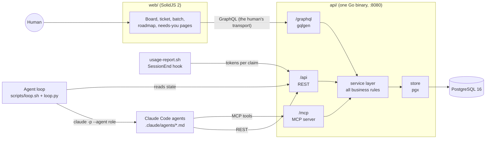
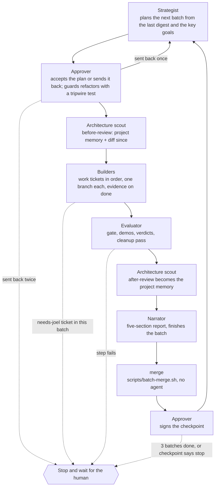
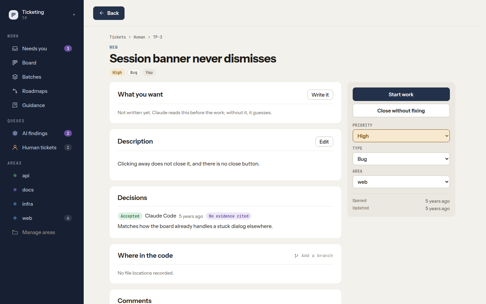
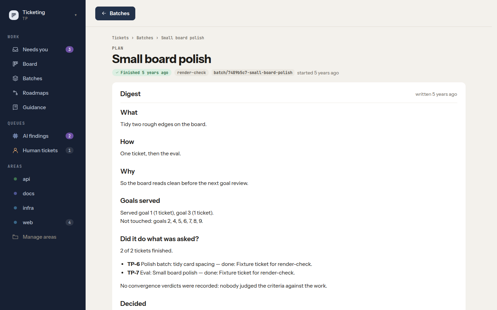
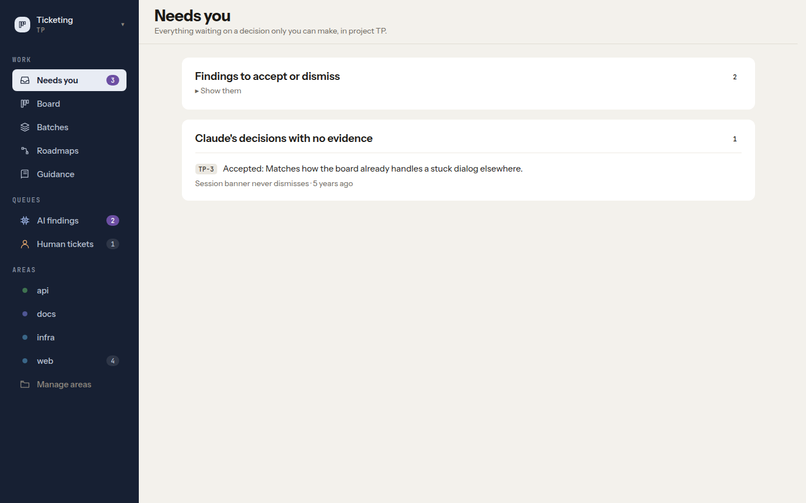
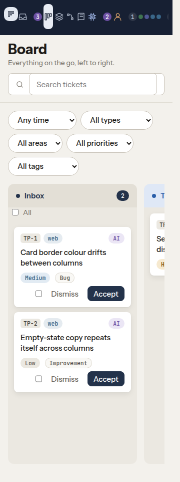

# Ticketing

A ticket tracker built so that Claude Code agents can file, claim and finish work through it, and a
human can still see and steer what they do. It has a Go API (GraphQL, REST and an MCP server over one
service layer), a PostgreSQL database and a SolidJS 2 web app. Around it sits an agent loop that plans,
builds, evaluates and reports on its own work in ordered batches. It stops whenever a decision belongs
to the human.

The tracker is also where its own development was planned and recorded. Most of the commit history
is tickets (`TP-123: ...`) and batches (`Merge batch/3-the-continuous-loop`) that were worked through it.



## Why it exists

When AI agents work on a codebase, the work drifts. Tasks get done out of order, decisions are made and
forgotten, code piles up, and nobody can say whether the project is getting better. Chat transcripts
make a poor record: you can't resume from one, judge one, or hand one to someone else.

This project makes the tracker the record. Every change is a ticket in an ordered batch, and every
decision is stored with its evidence. "Done" means evidence the API can check. Everything only a human
should decide waits in one queue. The agents talk to the tracker through the same rules as the web app,
so the rules live in one place and the agents can't quietly bend them.

## What it does

**For a person, in the browser**
- A board per project, per queue (AI findings, human tickets) and per area. You move tickets by
  dragging, and only legal moves light up during a drag, because the web app mirrors the API's
  transition table.
- Ticket pages with intent, description, decisions, code locations, comments and full history.
- A **Needs you** page listing everything waiting on the human: AI findings to accept or dismiss,
  finished batches awaiting a checkpoint, agent decisions that cite no evidence, proposed edits to
  fields the human owns, and tests waiting to be confirmed as tripwires.
- Batch and roadmap pages show which tickets were planned together, why, which guidance documents the
  agent was given (at the exact revision), and a digest of what happened.

**For an agent, over MCP or REST**
- `report_findings` files a batch of findings in one transaction. Each one is routed to an area by
  path globs and deduplicated by fingerprint, so a repeat finding bumps a counter instead of making
  a new ticket.
- `claim_next_ticket` hands out the next workable ticket (`FOR UPDATE SKIP LOCKED`, 30-minute claim
  expiry, strict batch order) in an envelope that carries the guidance for doing it, within a token
  budget and pinned by a SHA-256 hash.
- `record_decision`, `record_review`, `record_verdict`, `propose_ticket_edit`, `plan_batch` and about
  twenty more tools. The full list is in [`docs/api.md`](docs/api.md#mcp-tools-mcp-streamable-http-via-the-official-go-sdk).

**Rules the service enforces, whichever transport the call came in on** (26 in total, in [`docs/api.md`](docs/api.md#service-rules)):
- Optimistic locking: every update needs the ticket's `version`, and a stale one gets a 409.
- AI tickets land in `triage`, and only the human's transport (GraphQL) can move them out. REST and
  MCP refuse it, so an agent can't accept its own finding.
- A ticket's intent, constraints, non-goals and success criteria belong to the human. The agent writes
  the approach and verification, and can only *propose* changes to the human's part.
- `done` needs evidence by ticket type (a `verified_by` command and output, a worked example for a
  feature). The acceptance gate (`gate_passed`) can only be written by a script that runs held-out
  checks against Postgres directly. No API route can set it.
- Unknown request fields are refused by name. A model that guesses `area_id` instead of `area` gets a
  400 rather than a silent 201.

## Architecture



GraphQL, REST and MCP are thin. They parse, call the service and shape the response. Every rule
lives in `api/internal/service/`, so the board, `curl` and an agent all get the same answer. GraphQL
is treated as the human's transport: accepting triage, accepting a batch plan, signing a checkpoint
and editing a ticket's intent are only exposed there.

### The agent loop

`just loop` runs the project's agents one step at a time. `scripts/loop.py` holds no state. It reads
the tracker over REST and decides the next step with a pure function (`decide`, covered by
`scripts/test_loop.py`), so a run that crashed or was stopped with Ctrl-C resumes from the record.



Each step runs `claude -p --agent <role> --permission-mode dontAsk`, so a tool the role wasn't given
is denied rather than prompted for. Steps have a dollar cap (`LOOP_STEP_BUDGET_USD`, default 5), and
token usage is posted onto the ticket that was claimed. The Approver is separate from the Strategist
on purpose, because a planner that approves its own plans measures nothing. It acts over GraphQL as
`approver (delegated by joel)`, so the record shows the delegation. `scripts/demo-loop.sh` proves the
orchestration with fake agents. [`docs/guidance/the-agents.md`](docs/guidance/the-agents.md) has the
details.

`--project KEY` points the same loop at another project connected to the tracker, run in that
project's checkout. The role files name no project, directory or stack (a test fails if they do).
Each project's conventions come from its own guidance.

### Guidance served by the API

How a ticket is worked, how a finding is written and how the Go and web code should look are
**guidance documents stored in the database**, not prose in `CLAUDE.md`. `docs/guidance/` seeds them
once, and after that the database is the source of truth.
- A claim carries the documents that apply, within a token budget. A document that doesn't fit is
  listed under `omitted` with the call that fetches it.
- Revisions are immutable, and a claim records exactly which bytes it was served.
- Each document names the source paths it describes. `just guidance-check` uses git ancestry to fail
  any document whose code has changed since it was last reviewed.
- Agents report a wrong document with `report_guidance_drift` while they still have the code in front
  of them.

### Eval harness

`scripts/eval.sh` is an A/B runner for the question "does guidance change what an agent does?". Each
run gets its own throwaway repository clone and database. The arm (control or guided) is set by the
runner through request headers, so the agent never knows which arm it is in. The resulting diffs are
then judged by **blind pairwise reviewers** (`eval/reviewers/`: correctness, maintainer, scope auditor,
contract keeper, blind audit, adjudicator). Each reviewer runs with no tools, in an empty directory,
and sees every pair in both orders to cancel position bias.

Before any paid run, `just selftest` checks the reviewers against eight pairs whose answer is already
known, plus two probes. One probe checks that a judge can't tell what project it's in.
[`eval/selftest/README.md`](eval/selftest/README.md) explains each case. The held-out acceptance
checks live outside this repository on purpose, so an agent working in a clone can't read the answer
key.

This README doesn't quote A/B results, because no experiment results are committed. The harness and
its self-test are what this repository shows.

## Screenshots

These come from the committed render-check baselines (`scripts/render-baselines/`), which
`just render-check` re-renders in headless Chromium against fixed seed data on every gate run.

| Ticket | Batch digest |
|---|---|
|  |  |

| Needs you | Board at 360px |
|---|---|
|  |  |

## Tech stack

| Layer | Choice |
|---|---|
| API | Go 1.27, `net/http`, [gqlgen](https://gqlgen.com) (schema-first GraphQL), pgx v5, [MCP Go SDK](https://github.com/modelcontextprotocol/go-sdk) (streamable HTTP) |
| Database | PostgreSQL 16 in Docker, 14 SQL migrations, full-text search via `tsvector` |
| Web | SolidJS 2 (release candidate), TanStack Router 2 and Query 6, Vite 8, TypeScript |
| Agents | Claude Code subagents in `.claude/agents/`, driven by `claude -p` from `scripts/loop.sh` |
| Scripts | Bash and Python 3 (loop, gates, eval harness, demos) |
| Tests | Go tests against real Postgres, Vitest + Solid Testing Library, Python `unittest`, Playwright screenshot diffs |

## Run it

Prerequisites: Go 1.27+, Node 22, Docker, Python 3 and [`just`](https://github.com/casey/just).
The Justfile adds `~/.local/go/bin` to `PATH` in case Go is installed there.

```bash
just setup      # npm install for the web app
just dev        # Postgres in Docker (127.0.0.1:5434), API on :8080, web app on :5173
```

Open http://localhost:5173. GraphiQL is at http://localhost:8080/graphql. Configuration is by
environment variables (`DATABASE_URL`, `PORT`, `CORS_ORIGIN`). See [`.env.example`](.env.example).

With the API running:

```bash
just seed       # file this project's own review findings and chores as sample tickets
just guidance   # load docs/guidance/*.md into the database
just stop       # stop the database container (data stays in a Docker volume)
```

### Connect Claude Code

```bash
claude mcp add --transport http ticketing http://localhost:8080/mcp
```

The MCP server sends a short instructions block when a client connects. After that,
`claim_next_ticket` is where an agent gets the work and the guidance for doing it.

### REST in two calls

```bash
# file an AI finding (lands in triage unless its area auto-accepts AI tickets)
curl -s -X POST localhost:8080/api/tickets -H 'content-type: application/json' -d '{
  "title": "Search ignores ticket key", "type": "bug", "priority": "medium", "source": "ai",
  "locations": [{ "file_path": "api/internal/service/tickets.go", "line_start": 200 }]
}'

# update it; version is required, and a stale one returns 409
curl -s -X PATCH localhost:8080/api/tickets/TP-1 -H 'content-type: application/json' \
  -d '{ "version": 1, "priority": "high" }'
```

## Tests and results

Run on 2026-10-29 against this commit, on Linux with Postgres 16 in Docker:

| Suite | Command | Result |
|---|---|---|
| Go API (service rules; GraphQL, REST and MCP through the real router; agent-file guards; against real Postgres) | `cd api && go test ./...` | 144 tests passed |
| Web app (board rules, filters, pages; Vitest + jsdom) | `cd web && npm test -- --run` | 45 tests in 11 files passed |
| Loop, gate, guidance-check and tripwire scripts | `python3 -m unittest scripts/test_*.py` | 70 tests passed |
| Render guard (8 pages, desktop and 360px, pixel diff) | `just render-check` | 8 of 8 pages matched baseline |
| End-to-end demos (each on a throwaway database and API) | `scripts/demo-*.sh` | 13 of 13 scripts passed, 83 claims |

`just test` runs the first three. `just gate` runs lint (`gofmt`, `go vet`, a production web build),
the tests and the render guard, and stops at the first failure. Each Go test gets its own database,
cloned from a migrated template, so tests that race two connections against each other can run
alongside the rest.

The demos print `PASS`/`FAIL` per claim. Among them: a whole batch runs from plan to checkpoint with
fake agents (`demo-loop`), a held-out check blocks `done` until the work is right (`demo-checks`), an
agent can't cross the human-owned fields on REST (`demo-ownership`), and a second project connects
end to end (`demo-connect`).

## Repository layout

```
api/                 Go API
  internal/service/  every business rule (tickets, claims, batches, decisions, guidance, digest)
  internal/graph/    GraphQL resolvers; generated.go and gqlmodel/ come from the SDL in docs/api.md
  internal/rest/     REST handlers
  internal/mcpserver MCP tools and the claim envelope
  internal/store/    pgx queries
  internal/testdb/   per-test databases cloned from a migrated template
  migrations/        SQL migrations
web/src/             SolidJS app: routes/, components/, lib/ (board rules, filters), api/, styles/
docs/                schema.sql, api.md, design.md, guidance/ (seed corpus served to agents)
.claude/agents/      the agent roles the loop runs
scripts/             loop, gates (run-checks, guidance-check, render-check), eval harness, demos
eval/                blind reviewer prompts, verdict schema, reviewer self-test cases
```

## Documentation

- [`docs/api.md`](docs/api.md): the API contract. Endpoints, the 26 service rules, the GraphQL SDL
  the code is generated from, REST, MCP tools and the claim envelope.
- [`docs/schema.sql`](docs/schema.sql): the data model.
- [`docs/design.md`](docs/design.md): the web app's design brief and the Solid 2 migration notes.
- [`docs/guidance/the-system.md`](docs/guidance/the-system.md): the problem, the loop, and the rules
  every part keeps.
- [`docs/guidance/the-agents.md`](docs/guidance/the-agents.md): each agent's job, what stops the loop,
  and how to steer it.
- [`docs/guidance/key-goals.md`](docs/guidance/key-goals.md): the nine goals every batch is chosen
  and judged by.
- [`docs/guidance/working-a-ticket.md`](docs/guidance/working-a-ticket.md): branches, order, ownership
  and the evidence `done` needs.
- [`eval/selftest/README.md`](eval/selftest/README.md): how the reviewer self-test proves the judges
  can tell good changes from bad ones.
- [`CLAUDE.md`](CLAUDE.md): the short brief Claude Code reads first.

## How it was built

Joel Shore built this with Claude Code, and from early on through the tracker itself. Claude Code
sessions claimed tickets over MCP, worked each on its own branch, and recorded their evidence and
decisions. Joel set the goals and acceptance criteria and made the human-only calls. 124 of the 205
commits carry a Claude co-author line. The API was first written in Rust and ported to Go in the first
week.

## What I learned

Most of the rules above exist because something went wrong without them. The code comments record
each case:
- **Prose instructions rot.** Three statements in `CLAUDE.md` were wrong within a week of being written,
  and nothing noticed. That is why guidance moved into versioned, pinned documents with a drift check.
- **Drift checks can cry wolf too.** The first `guidance-check` compared commit hashes for equality
  and flagged documents pinned at merge commits as stale. It failed two batches' evals before it was
  rewritten as a git ancestry test.
- **A model guesses field names, and a silent success is the worst answer.** `area_id` instead of
  `area` once created an unrouted ticket and returned 201. Now unknown fields are refused by name.
- **Without authentication, the transport is the access control.** An agent could accept its own
  finding through `update_ticket`. Moving triage decisions to GraphQL only closed that gap.
- **AI judges have position bias.** Every pair is judged in both orders. A self-test with known answers
  runs before any paid evaluation, because a broken judge produces numbers just as readily as a
  working one.
- **Tests that never load the stylesheet can't catch a CSS regression.** The pixel-diff render guard
  was added to the gate after a CSS refactor had no test covering it.

## Limitations and what's next

- **No authentication.** The actor is a free-text header, so this is a local, single-team tool.
  Adding auth to the API is the next structural step.
- **Solid 2 is a release candidate**, as are the TanStack packages that peer on it, and `npm install`
  prints one peer-dependency warning.
- `just render-check` needs a locally cached Playwright and Chromium, and `just checks` needs the
  held-out checks directory (`$EVAL_CHECKS`), which isn't in this repository by design.
- The loop has been run on this project and on a scratch project in `demo-connect`. Running it on more
  real codebases, through `--project`, is what will show whether the machinery carries over.
